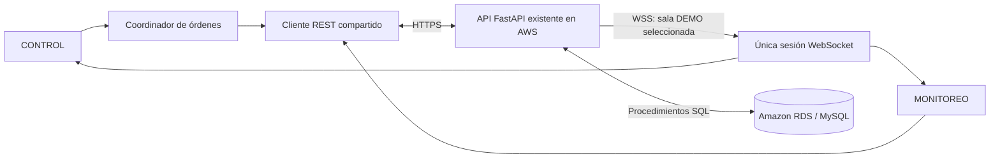

# Terra · Control y Monitoreo IoT

Frontend de la excavadora para la actividad práctica 4.1, con vistas **CONTROL** y **MONITOREO**. HTML semántico, CSS, Bootstrap local y módulos JavaScript nativos; reutiliza la API FastAPI existente y no incorpora otro backend.

Desarrollado por **Ricardo de Jesús Serrano Cortés · 2026**.

## Estado de esta entrega

Esta actualización integra CONTROL y MONITOREO y supera **68/68 pruebas automatizadas** con Fetch/WSS sustituidos. La revisión local comprobó ambas vistas en seis tamaños —12 combinaciones— sin scroll del documento, con diez filas de historial y DETENER de 44 px. La [validación completa](docs/monitoreo.md) distingue estos resultados de las pruebas reales de API. La publicación de esta actualización está autorizada y en proceso; falta registrar su resultado y comprobarla desde [GitHub Pages](https://elguerreromasfuertedesarahbonito.github.io/control-iot/).

El 11 de noviembre de 2026 se comprobaron HTTP 200 de OpenAPI, estado, historial y salud, además de CORS con el origen real de Pages. La primera auditoría leyó 537 filas y el [reporte de las 23:45 UTC](docs/evidencia-red.json) registró 563: corresponden a instantes distintos. El usuario confirmó el procedimiento SQL y UTC en MySQL.

Con autorización del usuario y el hardware desconectado, se probaron **POST reales contra la API** desde ambos joysticks, STOP y DEMO. Dos pestañas intercambiaron actualizaciones automáticas de estado/historial; un cliente Node independiente recibió bienvenida y eventos WSS reales. Una DEMO de ocho pasos y unos veinte segundos terminó sin añadir historial; navegar a MONITOREO no la canceló. Estos resultados validan el software y sus registros, sin acreditar movimiento físico. Postman/Thunder Client/extensión, teléfono físico y caídas reales de red siguen pendientes. Las evidencias locales se describen en [docs/monitoreo.md](docs/monitoreo.md).

## Control móvil

CONTROL conserva ambos joysticks, sus botones alternativos, DETENER, los tres estados de la última acción, favicon y créditos. La revisión de ambas vistas en 320×480, 390×844, 844×390, 915×240, 768×1024 y 1280×900 CSS px comprobó que el documento cabe en el viewport. En horizontal, los botones se integran alrededor de los círculos y la información ocupa una columna lateral. DEMO conserva su selector y ejecución/cancelación; en horizontal de hasta 600 px de alto y vertical de hasta 560 px, el botón **DEMO** abre esos mismos controles en un panel. La ayuda y las funciones adicionales están en **Info**, con desplazamiento interno si hace falta. Esta revisión usa tamaños de navegador y no equivale a una prueba en teléfono físico.

El joystick izquierdo controla desplazamiento. El derecho controla brazo y pala mediante los comandos reales del catálogo:

| Dirección | Comando |
| --- | --- |
| Arriba | `SUBIR_BRAZO` |
| Abajo | `BAJAR_BRAZO` |
| Izquierda | `ABRIR_PALA` |
| Derecha | `CERRAR_PALA` |

La última entrada que admite el coordinador conserva el control; al soltarla se solicita DETENER. Una nueva entrada neutraliza la anterior, cuya liberación tardía no detiene el nuevo gesto. No se combinan movimientos simultáneos. Se mantienen las flechas del teclado con el joystick enfocado, los botones alternativos y Escape. Pasar a MONITOREO libera la entrada y solicita STOP si había movimiento manual; la navegación interna no cancela por sí misma una DEMO. La parada global sigue disponible y la pérdida de foco/visibilidad conserva su política de seguridad independiente.

## Monitoreo

Muestra el último estado informado y hasta diez movimientos individuales persistidos mediante `GET /estado/{id_vehiculo}` y `GET /historial/{id_vehiculo}`. Ordena por `fecha_hora DESC, id_historial DESC`, conserva IDs distintos aunque repitan comando/fecha e incluye orígenes reales como `MANUAL`, `SEGURIDAD` y `WORKBENCH`.

Al abrir MONITOREO se consultan ambos recursos. La **única sesión WSS compartida**, de la sala DEMO seleccionada, actualiza estado y dispara lecturas agrupadas de historial cuando corresponde. La bienvenida/reconexión y el botón de actualización permiten resincronizar. No hay polling del historial ni filas inventadas desde WSS. Un paso DEMO no crea historial individual en el backend actual; una DEMO externa de otra sala o un `POST /historial` directo pueden requerir actualización REST.

Las fechas naïve de este backend tienen origen **UTC confirmado en MySQL** y se presentan en `America/Mexico_City`, conservando su ISO original. Sin una zona de origen configurada y confirmada, el formateador conserva la hora recibida y muestra «Zona del backend sin confirmar».

## Ejecutar localmente

Requiere Node.js 24 o una versión compatible con `package.json`. No necesita instalar paquetes.

```powershell
cd control-iot
node tools/serve.mjs
```

Abre `http://localhost:4173/` para utilizar los servicios reales configurados. MONITOREO realiza GET; los controles y DETENER pueden enviar POST al backend. `http://localhost:4173/?simulation=1` permite revisar CONTROL con su doble existente, sin acceso al servidor real. **MONITOREO requiere servicios reales y no muestra datos ficticios en ese modo.** Las fixtures unitarias no se presentan como registros de AWS.

Para ejecutar las pruebas automáticas:

```powershell
node --test tests/*.test.js
```

Las direcciones públicas están configuradas en `assets/js/config.js`: API `https://excavadora-iot-rsc.duckdns.org` y WebSocket `wss://excavadora-iot-rsc.duckdns.org/ws/demos/{id_demo}`. Las pruebas automatizadas sustituyen transportes y usan fixtures; se distinguen de las lecturas reales documentadas y de las pruebas operativas pendientes.

## Arquitectura y archivos



```text
control-iot/
  index.html                       navegación, vistas y diálogos
  assets/
    favicon.svg                    favicon original del proyecto
    css/styles.css                 diseño Mobile First y estados accesibles
    vendor/bootstrap.min.css       Bootstrap local, sin depender de un CDN al operar
    js/
      app.js                       composición única de servicios y vistas
      config.js                    URLs y zonas horarias públicas, sin secretos
      navigation.js                navegación por hash y estado de vista
      control-view.js              DOM y entradas de CONTROL
      connectivity.js              indicadores y ciclo de salud compartido
      api.js                       Fetch, contratos, errores y límites de espera
      catalog.js                   catálogo real y correspondencia de direcciones
      socket.js                    sesión WebSocket y reconexión
      coordinator.js               exclusión de operaciones y prioridad DETENER
      joystick.js                  Pointer Events, teclado y retorno a neutral
      manual-input.js              propiedad común de joysticks y botones
      monitoring-validation.js     contratos de estado e historial real
      date-time.js                 calendario estricto, UTC y presentación local
      monitoring/
        view.js                    campos y tabla mediante DOM seguro
        monitor.js                 coordinación REST/WSS
        latest-state.js            último estado y protección frente a REST tardío
        history.js                 historial persistido y consultas agrupadas
      simulation.js                doble de CONTROL; sin monitor ficticio
  tools/serve.mjs                   servidor estático de desarrollo
  tests/                           pruebas locales con servicios sustituidos
  deploy/Caddyfile                 configuración del proxy HTTPS/WSS del dominio
  docs/
    api-contract.md                contrato comprobado en las fuentes del backend
    pruebas.md                     pruebas A–E y comprobación externa WebSocket
    despliegue-ec2-windows.md       preparación de DuckDNS y Caddy en EC2 Windows
    entrega.md                     plantilla de contenido para el informe institucional
    rediseño-movil.md               validación histórica del rediseño
    monitoreo.md                   auditoría, arquitectura, pruebas y evidencias
  .github/workflows/pages.yml       pruebas y publicación del frontend
```

Los dos joysticks y los botones utilizan el mismo propietario de entrada y coordinador. Este descarta movimientos pendientes al solicitar DETENER y evita que una respuesta antigua restaure la indicación de movimiento. Si una operación ya estaba en vuelo, puede necesitar una cancelación o una parada final: abortar Fetch no cancela una operación aceptada en el servidor. No se reintentan automáticamente los movimientos.

Las DEMO se consultan e inician en el backend; el navegador no reproduce una secuencia fija ni crea registros individuales de sus pasos. MONITOREO representa el estado y las filas persistidas reales. No se agregan administración ni edición de catálogos.

## Configuración de la API

El [contrato de CONTROL](docs/api-contract.md) se complementa con el [contrato de MONITOREO](docs/monitoreo.md). El proyecto conserva por separado:

| Indicador | Qué permite afirmar |
| --- | --- |
| WebSocket del navegador | La sesión recibió una bienvenida válida del vehículo y la DEMO seleccionados. No demuestra presencia del ESP8266. |
| API AWS | La operación de salud configurada respondió; no significa que se probaron todas las operaciones. |
| Amazon RDS | **Sin verificar**: el `/health` actual devuelve `status` y el nombre de la BD, pero no consulta RDS. |

El texto «21 servicios» corresponde al enunciado. La copia auditada del backend contiene 26 operaciones REST propias y un WebSocket; el frontend utiliza las necesarias para CONTROL y MONITOREO. El campo `estado.conectado` es un dato escrito por el backend y no constituye un latido fiable del ESP8266 ni confirma movimiento físico.

GitHub Pages proporciona HTTPS al frontend, pero no convierte las direcciones `http://` y `ws://` de EC2 en conexiones seguras. El cliente utiliza la API HTTPS y el canal WSS existentes. La configuración de DuckDNS y Caddy se explica en [despliegue-ec2-windows.md](docs/despliegue-ec2-windows.md). La comprobación CORS de esta etapa empleó `https://elguerreromasfuertedesarahbonito.github.io`, sin subruta; el funcionamiento completo desde la nueva versión publicada se verificará después de desplegarla.

No se agregan tokens de DuckDNS, claves AWS, credenciales RDS ni secretos a `config.js`. El navegador no se conecta directamente a MySQL. Los datos remotos se representan como texto, no como HTML ejecutable. CORS no equivale a autenticación; la API actual no autentica sus routers y esta entrega no inventa un token o login local que parezca protegerla.

## Git y GitHub Pages

El frontend dispone de su repositorio `control-iot` bajo la cuenta `elguerreromasfuertedesarahbonito` y su [página publicada](https://elguerreromasfuertedesarahbonito.github.io/control-iot/). El [repositorio de API indicado por el alumno](https://github.com/elguerreromasfuertedesarahbonito/Vehiculo-iot-api) se mantiene separado; no subas la carpeta completa del proyecto IoT ni el backend al frontend.

La publicación de esta actualización está autorizada y en proceso; el resultado del workflow, commit y verificación final se registrarán al terminar. El workflow se ejecuta al actualizar `main`, prueba el código y publica únicamente `index.html`, `assets/` y `.nojekyll`; también permite ejecución manual. Los módulos nuevos están dentro de `assets/` y no requieren cambios en el backend ni dependencias nuevas.

Todas las referencias de recursos son relativas para funcionar bajo `/control-iot/`; la navegación utiliza hash. La publicación existente y la implementación local son versiones distintas hasta que termine correctamente el siguiente despliegue. El código completo se entrega como archivos del proyecto/ZIP y no se duplica íntegro en el README.

Antes de presentar la práctica, completa las [pruebas y evidencias](docs/pruebas.md), confirma la página desde un teléfono real y prepara el Word/PDF siguiendo [la plantilla de entrega](docs/entrega.md). Ya se proporcionaron los datos institucionales: Instituto Tecnológico de Pachuca (ITP), Ingeniería en Sistemas Computacionales, docente Víctor Pinedo Fernández, fecha de entrega 10/11/2026 y logotipo. El informe sigue siendo un borrador, con evidencias reales pendientes.
