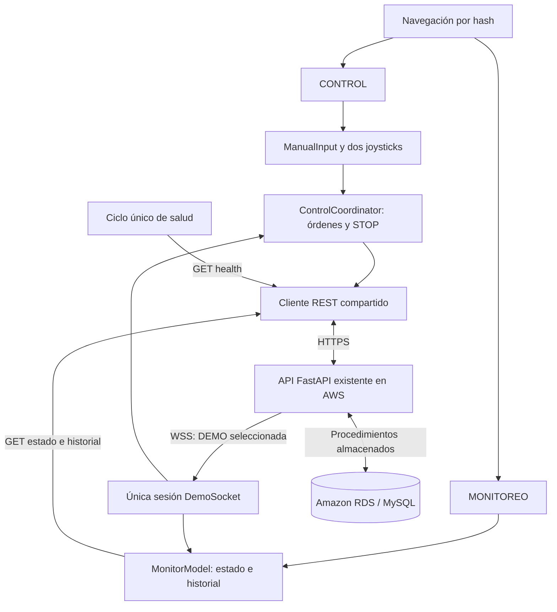

# CONTROL y MONITOREO: contrato, implementación y validación

Fecha: **11 de noviembre de 2026**. Autor: **Ricardo de Jesús Serrano Cortés · 2026**.

## Alcance y evidencia disponible

MONITOREO se integra al frontend existente conservando CONTROL, dos joysticks, DEMO, parada prioritaria, indicadores, favicon y créditos. Reutiliza FastAPI en AWS, RDS y HTTPS/WSS. No crea otro backend ni modifica procedimientos SQL.

La auditoría obtuvo HTTP 200 reales de OpenAPI, `/estado/1`, `/historial/1` y `/health`, y comprobó CORS con `https://elguerreromasfuertedesarahbonito.github.io`, sin la subruta de Pages. La primera lectura contenía **537 registros**; el [reporte de las 23:45 UTC](evidencia-red.json) contiene **563**. Son muestras en momentos distintos de un historial que siguió recibiendo órdenes. El usuario facilitó el procedimiento SQL y confirmó UTC.

Después de la auditoría se ejecutaron pruebas reales de la API y WSS **autorizadas por el usuario, con el hardware desconectado**. Se probaron manuales/STOP, actualización automática entre dos pestañas, observación desde Node independiente, finalización y cancelación de DEMO. Las 68 pruebas automatizadas sustituyen Fetch/WSS y se registran aparte. Ninguna de estas pruebas acredita movimiento físico ni caídas reales de conectividad.

| Comprobación | Situación |
| --- | --- |
| Contratos locales y JSON real de estado/historial | Comprobados mediante fuentes y GET reales. |
| Salud HTTP, OpenAPI y CORS para Pages | HTTP 200 y respuesta CORS observados. |
| Procedimiento SQL y zona UTC | Confirmados con la información SQL del usuario. |
| Pruebas automatizadas | **68/68 aprobadas**, con Fetch/WSS sustituidos. |
| UI local | Dos vistas × seis tamaños: 12 combinaciones, documento igual al viewport, STOP de 44 px. |
| Manuales/STOP y dos pestañas | API real, hardware desconectado, propagación automática WSS + REST comprobada. |
| Observador WSS independiente | Cliente Node real recibió bienvenida y MANUAL; Postman/Thunder Client/extensión no utilizados. |
| DEMO real | Ocho pasos, unos veinte segundos, finalización y cancelación comprobadas; navegación interna no canceló. |
| Dispositivo físico y movimiento | Pendientes; no se probaron motores/placa conectados. |
| Caídas reales de HTTP/WSS/Wi-Fi | Pendientes; fallos y recuperación cubiertos solo con sustitutos unitarios. |
| Publicación de esta actualización | Autorizada y en proceso; falta registrar resultado/commit y revisión desde Pages. |

### Pruebas reales de API y WSS

1. El canal real entregó una `bienvenida` de origen `TELEMETRIA`, `corriendo:false`, para el vehículo y la sala seleccionados.
2. En la pestaña A, CONTROL recibió `ArrowUp` en el joystick de desplazamiento: la API registró `AVANZAR` y STOPs de compensación, IDs **564–566**. MONITOREO de la pestaña B actualizó estado y diez filas automáticamente mediante WSS y GET de historial.
3. El cliente independiente `tools/observe-wss.mjs` observó una bienvenida y eventos MANUAL de `AVANZAR`/`DETENER`, registrados en `artifacts/live-wss.json`. Este cliente valida observación independiente real; no se etiqueta como Postman, Thunder Client o extensión.
4. Se ejecutó la DEMO de ocho pasos y unos veinte segundos hasta finalizar. Pasar CONTROL→MONITOREO durante su ejecución no la canceló. El historial tenía **566 filas antes y después**, sin cambios: `artifacts/demo-verification.json` registra `unchanged:true` y `corriendo:false` al finalizar.
5. La pestaña B actuó después como origen de CONTROL: `ArrowLeft` en el joystick de herramienta generó `ABRIR_PALA` y STOPs, IDs **567–569**. La pestaña A reaccionó automáticamente.
6. Se inició otra DEMO y se probó Cancelar. La parada manual explícita posterior creó el ID **570**; corresponde al POST de STOP, no a registros de pasos DEMO.

El estado y el historial persistidos cambiaron realmente, aun sin hardware. No se interrumpieron AWS ni Wi-Fi para estos escenarios y no se atribuye una prueba física a los acuses HTTP/WSS.

### Evidencias disponibles

| Archivo | Evidencia |
| --- | --- |
| [evidencia-red.json](evidencia-red.json) | GET reales, CORS, fecha UTC y 563 filas en la auditoría de las 23:45. |
| `artifacts/live-wss.json` | Bienvenida y MANUAL observados desde el cliente Node independiente. |
| `artifacts/demo-verification.json` | Historial sin cambios antes/después de la DEMO completada. |
| `artifacts/responsive-audit.json` | Medidas de las doce combinaciones vista/tamaño. |
| `artifacts/monitor-mobile.jpg` | Captura local de MONITOREO con datos del servicio real. |

Los archivos `artifacts/` existen localmente, están ignorados por Git y se incluyen en la entrega ZIP; no se presentan como enlaces disponibles desde el repositorio publicado. El diagnóstico de red sí está documentado en `docs/evidencia-red.json`.

## Contratos REST reales

| Operación | Contrato |
| --- | --- |
| `GET /estado/{id_vehiculo}` | ID entero. `EstadoOut`; HTTP 404 si no existe estado. |
| `GET /historial/{id_vehiculo}` | ID entero, sin filtros, límite ni paginación declarados. Devuelve las filas del procedimiento, o `[]`. |
| `GET /health` | `{status:"ok",db:string}`; no ejecuta SQL ni comprueba RDS. |
| `GET /vehiculos/{id_vehiculo}` | Identidad del vehículo mostrada por la interfaz. |
| `GET /comandos/vehiculo/{id_vehiculo}` | Catálogo con IDs y códigos reales para CONTROL. |
| `GET /demos/vehiculo/{id_vehiculo}` | Demos disponibles; la seleccionada define la sala WSS. |

La copia auditada contiene **26 operaciones REST propias y un WebSocket**; no se cuentan páginas automáticas de documentación. «21 servicios» procede del enunciado y no equivale a haber probado todos los endpoints.

### Último estado

| Campo requerido | Tipo |
| --- | --- |
| `id_vehiculo` | Entero positivo. |
| `vehiculo` | Texto. |
| `id_comando` | Entero positivo o `null`. |
| `comando` | Texto o `null`. |
| `codigo` | Entero o `null`. |
| `conectado` | Booleano. |
| `fecha_actualizacion` | Fecha ISO válida. |

La lectura observada incluía vehículo 1, `id_comando:9`, `comando:"DETENER"`, `codigo:9`, `conectado:true` y `fecha_actualizacion:"2026-11-11T23:33:01"`. Los manuales y pasos DEMO pueden escribir `conectado=true`: no es un heartbeat independiente ni una confirmación física.

HTTP 404 representa ausencia de estado. Los fallos de red, HTTP, timeout o contrato se presentan como error; si hay datos anteriores, se conservan identificados como pendientes de actualización. Un fallo no se convierte en vehículo detenido o historial vacío confirmado.

### Historial persistido

| Campo confirmado | Tipo |
| --- | --- |
| `id_historial` | Entero positivo; identidad persistente de fila. |
| `id_vehiculo` | Entero positivo. |
| `comando` | Texto o `null`, por `LEFT JOIN` con comandos. |
| `codigo` | Entero o `null`, por el mismo `LEFT JOIN`. |
| `fecha_hora` | Fecha ISO válida. |
| `origen` | Texto de 1–30 caracteres. |

La fila observada con ID 537 correspondía a `DETENER`, código 9, `2026-11-11T23:33:01` y origen `MANUAL`. También existen etiquetas `SEGURIDAD` y `WORKBENCH`; no se excluyen por no llamarse `MANUAL`.

El procedimiento confirmado aplica **`ORDER BY h.fecha_hora DESC, h.id_historial DESC`** y no tiene `LIMIT`. El router tampoco declara un parámetro `limit`. El frontend descarga el arreglo, valida sus filas, filtra el vehículo seleccionado, copia campos conocidos, deduplica únicamente `id_historial`, aplica ese orden y muestra **hasta diez**. El límite es de presentación y no reduce la transferencia del servidor. Paginar en el futuro requeriría cambiar el contrato; esta entrega no inventa ese parámetro.

Dos comandos iguales registrados en el mismo segundo con IDs distintos son movimientos diferentes. No se deduplican por comando, fecha, código u origen. El UUID WSS `id_evento` no se persiste como ID de historial ni se equipara a `id_historial`.

Los pasos, pausas y paradas del runner DEMO actualizan estado, pero **no crean registros individuales de historial**. Tampoco lo hace la telemetría. Existe `POST /historial`, que inserta directamente sin emitir WSS: un cambio por esa vía aparece en la siguiente lectura REST. MONITOREO no ejecuta ese POST.

## Fechas y zona horaria

El usuario confirmó `@@global.time_zone`, `@@session.time_zone` y `@@system_time_zone` en UTC, además de la coincidencia de `NOW()` y `UTC_TIMESTAMP()`. La integración configura `sourceTimeZone:"UTC"` y `displayTimeZone:"America/Mexico_City"`.

Las fechas naïve del backend representan UTC conforme a esa confirmación y se convierten con `Intl`. `2026-11-11T23:33:01` se presenta como **11/11/2026, 17:33:01** en `America/Mexico_City`. Un ISO con `Z` u offset conserva primero su propio significado temporal. El ISO recibido permanece como dato original.

Sin zona de origen confirmada/configurada, el formateador conserva los componentes naïve y muestra **«Zona del backend sin confirmar»**; no usa `Date.parse()` para asignarles la zona del navegador. Una fecha nula/inválida muestra `—`. Se rechazan fechas imposibles, horas fuera de rango y offsets inválidos sin aceptar rollover. La clave de orden conserva precisión de nanosegundos y normaliza los offsets y los naïve UTC de este contrato.

## Arquitectura compartida



La navegación cambia el panel visible conservando DOM de CONTROL, selección DEMO, listeners y coordinador. No crea otro socket ni reconecta por cambiar de pestaña. Antes de ocultar CONTROL, libera la entrada y solicita STOP si había manual activo. Una DEMO continúa durante la navegación interna; DETENER global sigue disponible. La política de pérdida de foco/visibilidad de la ventana se conserva por separado.

Una bienvenida válida identifica vehículo y sala. Abrir el transporte sin recibirla no habilita órdenes. Los manuales y la telemetría se difunden a las salas activas del vehículo; los eventos DEMO pertenecen a su propia sala. **Una sala seleccionada no observa necesariamente otra DEMO iniciada desde un cliente externo.** No hay replay persistente ni canal WSS separado por vehículo.

### Módulos

```text
assets/js/
  app.js                       composición única de servicios y vistas
  navigation.js                selección por hash y accesibilidad
  control-view.js              DOM, joysticks, botones y panel DEMO
  connectivity.js              salud e indicadores compartidos
  api.js                       REST y métodos state/history
  socket.js                    observador WSS único y reconexión
  coordinator.js               prioridad STOP y correlación HTTP/WS
  manual-input.js              propiedad de la entrada manual
  monitoring-validation.js     contratos EstadoOut e historial real
  date-time.js                 validación, orden y presentación de fechas
  monitoring/
    view.js                    campos y tabla mediante DOM seguro
    monitor.js                 coordinación REST/WSS
    latest-state.js            estado y revisión de eventos
    history.js                 consultas agrupadas de filas persistidas
```

El catálogo, los joysticks y los recursos gráficos locales de CONTROL se conservan. No se añaden dependencias para renderizar MONITOREO.

### Sincronización y carreras REST/WSS

1. Al entrar en MONITOREO se leen estado e historial, con carga/error independientes.
2. La bienvenida o recuperación WSS solicita resincronización agrupada; el usuario puede actualizar manualmente.
3. Un snapshot válido actualiza estado. Un contador de revisión impide que un GET iniciado antes sobrescriba un estado WSS posterior.
4. Un MANUAL nuevo se reconoce por `id_evento` y programa GET de historial; no crea una fila desde el socket.
5. Las ráfagas comparten una lectura en curso y marcan otra pendiente si llegan cambios durante ella. Generaciones/contextos descartan respuestas viejas y abandonar el panel cancela lecturas.
6. La tabla representa hasta diez filas persistidas y usa texto seguro; los IDs mantienen la identidad del registro.

Un paso DEMO carece de fecha persistida y acuse físico. Si aparece como actividad reciente, no se le inventa fecha, conexión física o fila histórica. MONITOREO no sondea periódicamente estado/historial; el ciclo existente de `/health` es independiente y compartido.

La tabla dispone de scroll interno cuando es necesario. La revisión comprobó que sus columnas caben sin desplazamiento horizontal en 320×480 y 390×844; las diez filas permanecen dentro de su contenedor. Los grids reducen sus elementos sin ampliar el documento. CONTROL conserva su presupuesto de altura y layouts portrait/landscape, medidos junto con la navegación.

## Disponibilidad y seguridad

| Dato | Interpretación |
| --- | --- |
| API disponible | Respondió `/health`, sin validar todas las operaciones. |
| WS en línea | Bienvenida válida de la sala seleccionada. |
| RDS «Sin verificar» | Falta diagnóstico independiente de BD; `/health` no ejecuta SQL. |
| GET correcto | La lectura concreta funcionó en ese momento; no prueba disponibilidad continua. |
| `conectado:true` | Dato informado por la API; no prueba placa/motor en línea. |

La API actual no autentica sus routers. No se inventan login, token o permiso local que parezcan protegerla. Los recursos públicos no incluyen credenciales AWS/RDS ni tokens DuckDNS. El navegador usa la API HTTPS y nunca MySQL directamente.

CORS se comprobó con el origen real de Pages, sin `/control-iot/`. No equivale a autenticación ni valida por sí mismo la política `Origin` de WSS. Se mantienen HTTPS/WSS, validación, límite de trama, timeout, errores y reconexión progresiva. El socket es observador: no emite `accion:estado`, órdenes o escrituras. Los datos remotos se asignan con `textContent`, sin interpretar HTML o introducir atributos remotos.

En `?simulation=1`, CONTROL conserva su doble y MONITOREO informa que necesita servicios reales. No muestra telemetría ficticia como datos de AWS. Las fixtures quedan restringidas a las pruebas unitarias.

## Casos de validación

Los siguientes casos distinguen las pruebas unitarias, las comprobaciones locales con servicios reales y lo todavía pendiente. Los POST reales se autorizaron con el hardware desconectado; sí escribieron estado/historial.

| Caso | Resultado requerido | Evidencia |
| --- | --- | --- |
| Carga inicial real | Estado y hasta diez filas; 537/563 son muestras, no límites del servidor. | Aprobado: GET real y captura local de MONITOREO. |
| Estado 404 e historial vacío | Ausencia de registros diferenciada de error. | Automatizada. |
| Datos desordenados y empate | Fecha DESC e ID DESC. | Fixtures unitarias. |
| Mismo comando/segundo | Se conservan IDs distintos; se deduplica solo el mismo ID. | Aprobado: fixtures; STOPs reales conservados con IDs diferentes. |
| Origen y nulos del LEFT JOIN | Mantiene etiquetas reales y muestra campos vacíos correctamente. | Contrato real y pruebas. |
| UTC, offset y medianoche | Hora México correcta, ISO conservado y fecha imposible rechazada. | SQL confirmado y pruebas. |
| HTTP/WSS fuera de orden | REST tardío no pisa dato vivo ni confirma otra orden. | Coordinador/modelo. |
| Ráfagas durante GET | Agrupación y lectura posterior, sin perder actualización final. | Promesas controladas. |
| Navegación en reposo | Mismo WSS y ningún POST por cambiar de vista. | Aprobado en navegador local con servicios reales. |
| Navegación con manual | Neutraliza, solicita STOP y no reanuda un gesto tardío. | Automatizada; operación real separada. |
| Navegación con DEMO | No cancela la secuencia; DETENER global accesible. | Aprobado: DEMO real completada y segunda DEMO cancelada. |
| Dos pestañas y cliente independiente | El origen manual se refleja en la otra pestaña y Node recibe MANUAL. | Aprobado: IDs 564–569 y `live-wss.json`; herramienta Postman/Thunder/extensión pendiente. |
| Caída y recuperación HTTP/WSS | Indicadores separados, datos marcados y resincronización. | Aprobado solo en unitarias; caída de red real pendiente. |
| Otra sala/inserción directa | REST descubre cambios que no llegaron por la sala seleccionada. | Contrato; escenario operativo pendiente. |
| Timeout/JSON inválido/HTTP 4xx–5xx | Error claro sin historial ficticio ni reintento de movimiento. | Transportes sustituidos. |
| Texto remoto con script/HTML | Texto visible, sin ejecución. | Prueba y revisión DOM. |
| Modo simulado | MONITOREO sin GET a AWS ni historial ficticio. | Navegador y automatizada. |
| Orientación y tamaños | Documento sin scroll, diez filas y STOP de 44 px. | Aprobado: 12 combinaciones de navegador; dispositivo físico pendiente. |
| Pages bajo subruta | Recursos relativos, hashes, GET/CORS y WSS correctos. | Publicación autorizada/en proceso; revisión posterior pendiente. |

### Accesibilidad

- [x] Entrada por teclado de ambos joysticks comprobada; navegación con `aria-current`, foco visible y paneles ocultos/inertes revisados en código.
- [x] Controles ocultos fuera del foco y DETENER global disponible en ambas vistas.
- [x] Nombres accesibles de joysticks, botones, selector y diálogos conservados en el DOM.
- [x] Encabezados de tabla y avisos de estado revisados sin convertir toda la tabla en región viva.
- [x] Carga, errores, fuente, fechas y datos pendientes representados; errores cubiertos con transportes sustituidos.
- [x] Portrait/landscape y seis tamaños comprobados en navegador.
- [ ] Lector de pantalla real, medición de contraste y ampliación de texto como revisión específica.
- [ ] Prueba desde teléfono físico.

### Seguridad y resiliencia

- [x] Sesión WSS compartida; las lecturas de MONITOREO no generan POST ni escrituras WSS.
- [x] Contratos/vehículo, DOM seguro y ausencia de secretos/autenticación ficticia revisados.
- [x] REST tardío y contextos anteriores cubiertos mediante pruebas unitarias.
- [x] Ráfagas, reconexión y cancelaciones cubiertas en unitarias; no se declara caída real.
- [x] Errores y vacío diferenciados, conservando evidencia válida, mediante pruebas unitarias.
- [x] CORS HTTP y WSS real observados por separado; RDS permanece «Sin verificar».
- [ ] Interrupción y recuperación reales de red/API/WSS.
- [ ] Diagnóstico independiente de RDS y autenticación de backend: fuera de este cambio frontend.

## Ejecución, evidencias y publicación

Ejecutar `node --test tests/*.test.js` y `node tools/serve.mjs` desde `control-iot`. La URL local sin `simulation=1` utiliza la API real; MONITOREO lee y CONTROL puede emitir órdenes. [rediseño-movil.md](rediseño-movil.md) conserva pruebas históricas y no sustituye las de esta actualización.

Resultado de la revisión responsive: **12 combinaciones**, dos vistas por cada uno de los seis tamaños siguientes. En todas, las dimensiones del documento coinciden con el viewport y DETENER mide 44 px de alto.

| Viewport CSS px | Diámetro medido del joystick en CONTROL | MONITOREO |
| --- | --- | --- |
| 320×480 | 101 px | Diez filas; tabla sin overflow horizontal. |
| 390×844 | 169 px | Diez filas; tabla sin overflow horizontal. |
| 844×390 | 268 px | Diez filas dentro de su contenedor. |
| 915×240 | 144 px | Diez filas dentro de su contenedor. |
| 768×1024 | 268 px | Diez filas dentro de su contenedor. |
| 1280×900 | 268 px | Diez filas dentro de su contenedor. |

Las medidas están en `artifacts/responsive-audit.json`. La emulación de tamaño no se etiqueta como teléfono físico. Otros tamaños de [rediseño-movil.md](rediseño-movil.md) corresponden a la revisión histórica, no al conteo de esta versión.

Resultado automatizado: **68 pruebas aprobadas, cero fallos**, con Fetch/WSS sustituidos. No se presentan como pruebas de disponibilidad de AWS. Las evidencias reales de esta sesión se enumeran arriba y se separan de fixtures y de la prueba física pendiente. Cada registro conserva su fecha/entorno; el contador de historial puede cambiar con nuevas órdenes.

El workflow de Pages prueba y publica `index.html`, `assets/` y `.nojekyll`. Los módulos nuevos se incluyen al copiar `assets/`; no se necesita otro backend ni instalar paquetes. La publicación está **autorizada y en proceso**; falta registrar commit, resultado del workflow y comprobación desde la URL publicada. Mantener las rutas relativas y verificar hashes bajo `/control-iot/`. Postman/Thunder Client/extensión sigue como evidencia específica pendiente aunque ya se validó el cliente Node independiente.

El código completo se entrega como archivos del proyecto/ZIP, sin duplicarlo íntegro en README o informe. [pruebas.md](pruebas.md) conserva escenarios A–E y [entrega.md](entrega.md) la guía institucional.
